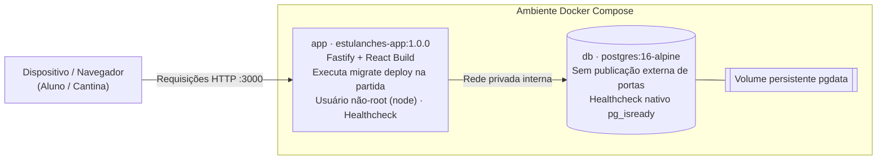

#Meu video
https://drive.google.com/drive/folders/1edCl-XeCCsaHmWStqAkEi-dyvfbpU9Zd?usp=sharing

# EstuLanches

Plataforma integrada para gerenciamento de cardápio digital e fila de atendimento em cantinas escolares. O sistema oferece aos alunos a conveniência de realizar pedidos e monitorar o status de preparo diretamente pelo celular, enquanto disponibiliza à equipe da cantina um painel em tempo real para controle da fila, despacho de pedidos e gestão automatizada do estoque.

**Objetivo e problemas atendidos:** extingue o congestionamento nos intervalos escolares, elimina o uso de anotações manuais em papel, previne divergências financeiras e de troco e impede a comercialização de produtos sem saldo em estoque.

## Visão Geral da Arquitetura

A solução é executada por meio de dois serviços conteinerizados sob orquestração do **Docker Compose**: o contêiner de **aplicação** (`app`, englobando a API Fastify e os arquivos estáticos compilados do front-end em React) e o banco de dados relacional **PostgreSQL** (`db`). Por diretriz de segurança, exclusivamente a porta `3000` da aplicação é exposta externamente; o banco de dados opera isolado em uma rede interna restrita, persistindo seus registros no volume nomeado `pgdata`.



### Tecnologias Utilizadas

| Componente | Especificação Tecnológica |
|---|---|
| **Interface (Front-end)** | React + Vite + TypeScript, estilização customizada orientada a variáveis CSS (tema Moderno & Tech), React Router |
| **Serviço de Backend (API)** | Node.js 22 LTS + Fastify 5, telemetria e registros em JSON via logger Pino |
| **Validação de Dados** | Zod (estruturas de entrada e integridade de variáveis de ambiente) |
| **Camada de Dados & ORM** | PostgreSQL 16 + Prisma ORM (migrações declarativas e versionadas) |
| **Autenticação & Criptografia** | Tokens JWT (`@fastify/jwt`) e criptografia de senhas com algoritmo bcrypt |
| **Segurança em Camada HTTP** | Proteções de cabeçalhos (`@fastify/helmet`), limitação de taxa (`@fastify/rate-limit`) e política de CORS (`@fastify/cors`) |
| **Suíte de Testes** | Vitest com injeção de requisições em memória (`fastify.inject()`) e relatórios de cobertura v8 |
| **Infraestrutura & Empacotamento** | Dockerfile multi-estágio com orquestração via Docker Compose |

## Instruções de Inicialização

**Pré-requisitos:** Docker Desktop (ou Docker Engine com plugin Compose v2 devidamente configurado).

### 1. Configuração das Variáveis de Ambiente

Crie o arquivo de configuração local a partir do modelo base:

```bash
# No PowerShell:
Copy-Item .env.example .env

# Em sistemas Unix / Bash:
cp .env.example .env
```

> **Atenção:** abra o arquivo `.env` gerado e defina valores seguros para as credenciais com o prefixo `"troque-isto..."`.

### 2. Construção e Execução dos Serviços

Execute a compilação das imagens e suba os contêineres em segundo plano:

```bash
docker compose up -d --build
```

A aplicação estará acessível em **http://localhost:3000**. Durante a inicialização inicial, o contêiner aplica automaticamente as migrações estruturais do banco de dados e, se o parâmetro `SEED=true` estiver habilitado, popula os dados iniciais de demonstração.

### 3. Comandos Úteis de Operação

```bash
# Monitorar o estado e a saúde dos serviços:
docker compose ps

# Visualizar as últimas linhas de registros da aplicação:
docker compose logs app --tail=50

# Testar o status de integridade do serviço via linha de comando:
curl http://localhost:3000/api/health

# Finalizar os serviços preservando os dados gravados no volume:
docker compose down
```

### Credenciais Pré-configuradas para Teste

| Perfil de Acesso | Endereço de E-mail | Senha Padrão |
|---|---|---|
| **Cantina (ADMIN)** | `cantina@estulanches.local` | Valor atribuído a `SEED_ADMIN_PASSWORD` no `.env` |
| **Aluno (ALUNO)** | `aluno@estulanches.local` | Valor atribuído a `SEED_ALUNO_PASSWORD` no `.env` |

> Novos usuários podem realizar o auto-cadastro diretamente pela interface pública da aplicação (o registro espontâneo sempre cria contas com papel `ALUNO`).

## Validação e Testes Automatizados

A suíte de testes executa em um ambiente Docker dedicado, instanciando uma base PostgreSQL efêmera (isolada e em memória):

```bash
docker compose --profile test run --rm tests
```

### Escopo das Validações

- **Testes Unitários** (`backend/tests/unit`, isolados de banco de dados): validação do cálculo monetário preciso com tipos decimais, conformidade do autômato de estados dos pedidos (transições válidas e rejeitadas), mecanismos de aferição de estoque, schemas de entrada do Zod e derivação criptográfica de senhas.
- **Testes de Integração** (`backend/tests/integration`): inicializa o ecossistema completo da API com `buildApp()` e submete requisições via `inject()` contra a base relacional real. Abrange fluxo de autenticação, checagem de permissões e controle de acesso (401/403), criação de pedidos com débito atômico de estoque, neutralização de preços manipulados enviados pelo front-end, bloqueio de pedidos excedentes ao estoque disponível (resposta 409 com reversão de transação), progressão de status (200/422), estorno de estoque em cancelamentos e garantia de isolamento entre dados de alunos distintos (404).
- **Metas de Cobertura de Código:** estabelecido patamar mínimo de 70% de cobertura nos módulos `src/domain` e `src/modules/**/service.ts`, validado rigidamente pelos limiares (`thresholds`) do Vitest. Caso os índices fiquem abaixo do limite, o processo de validação é interrompido com falha.

## Mapeamento de Rotas da API (Prefixo `/api`)

| Método | Caminho | Autorização | Resposta Típica |
|---|---|---|---|
| `GET` | `/health` | Público | `200` `{status: "ok", db: "up"}` ou `503` |
| `POST` | `/auth/register` | Público | `201` `{token, usuario}` (perfil atribuído: ALUNO) |
| `POST` | `/auth/login` | Público (limite: 5 req/min por IP) | `200` `{token, usuario}` ou `401` |
| `GET` | `/categorias` | Público | `200` listagem de categorias cadastradas |
| `POST` · `PUT` · `DELETE` | `/categorias[/:id]` | ADMIN | `201` / `200` / `204`; `409` caso possua produtos vinculados |
| `GET` | `/produtos?categoriaId=` | Público | `200` apenas itens ativos com estoque disponível |
| `GET` | `/admin/produtos` | ADMIN | `200` catálogo integral, incluindo itens desativados |
| `POST` · `PUT` | `/produtos[/:id]` | ADMIN | `201` / `200` |
| `DELETE` | `/produtos/:id` | ADMIN | `204` (desativação lógica: `ativo = false`) |
| `POST` | `/pedidos` | ALUNO | `201`; `400` payload incorreto; `409` estoque insuficiente |
| `GET` | `/pedidos/meus` | ALUNO | `200` histórico de pedidos do usuário autenticado |
| `PATCH` | `/pedidos/:id/cancelar` | Autor do pedido ou ADMIN | `200`; `404` caso pertença a outro aluno; `422` status não cancelável |
| `GET` | `/pedidos?status=` | ADMIN | `200` visualização da fila geral de pedidos |
| `PATCH` | `/pedidos/:id/status` | ADMIN | `200`; `422` em transições de status proibidas |

Estrutura padronizada de mensagens de erro:
```json
{
  "erro": {
    "codigo": "ESTOQUE_INSUFICIENTE",
    "mensagem": "Não há estoque suficiente para atender o item informado."
  }
}
```

**Ciclo de Vida do Pedido:** `RECEBIDO → EM_PREPARO → PRONTO → ENTREGUE`. É admitido o cancelamento quando o pedido estiver no status `RECEBIDO` (pelo aluno titular ou pela cantina) ou em `EM_PREPARO` (exclusivo para a cantina), promovendo o estorno imediato dos itens ao estoque. Qualquer avanço ou recuo fora do fluxo homologado retorna status HTTP 422.

## Diretrizes e Práticas de Segurança

| Risco / Cenário de Ameaça | Mecanismo de Proteção Implementado |
|---|---|
| **Exposição de senhas** | Derivação com algoritmo bcrypt (custo computacional 10); hashes nunca são retornados pela API e dados sensíveis sofrem censura automática em logs (`redact` do Pino). |
| **Acesso indevido ou usurpação** | Tokens JWT com validade estrita de 8 horas; validação de perfis (ADMIN/ALUNO); segregação de dados onde alunos só consultam pedidos próprios (consultas a terceiros retornam 404). |
| **Manipulação de valores no cliente** | O front-end encaminha unicamente o identificador do produto e a quantidade; preços unitários e somatórios totais são obtidos diretamente da base de dados. |
| **Concorrência e venda sem estoque** | Transações relacionais atômicas com `UPDATE ... WHERE estoque >= quantidade`; qualquer item que falhe causa rollback integral da operação. |
| **Injeção de comandos SQL (SQLi)** | Consultas totalmente parametrizadas gerenciadas pelo Prisma ORM combinadas à sanitização e validação de tipos com Zod. |
| **Tentativas de força bruta no login** | Limitador de taxa de requisições configurado para o teto de 5 tentativas por minuto por endereço IP. |
| **Ataques via cabeçalhos e CORS** | Configuração de cabeçalhos de segurança via Helmet e restrição rígida de origens permitidas via plugin CORS. |
| **Comprometimento de credenciais em repositório** | Exclusão do `.env` no `.gitignore` e `.dockerignore`; versionamento restrito ao `.env.example`; a aplicação recusa a inicialização caso `JWT_SECRET` tenha menos de 32 caracteres. |
| **Vulnerabilidade em contêineres** | Processo executado sob usuário com privilégios reduzidos (`node`), expurgo de dependências de desenvolvimento e limites estipulados de memória e processador. |
| **Exposição do banco de dados** | Instância do PostgreSQL operando sem mapeamento de portas externas, acessível estritamente através da rede privada interna criada pelo Compose. |

> **Considerações de evolução:** para cenários produtivos com exposição pública, a terminação segura TLS/HTTPS deve ser centralizada em um proxy reverso/balanceador de carga. Além disso, a alocação de tokens em `localStorage` pode evoluir para cookies assinados com diretiva `httpOnly`.

## Projeção de Escala e Alta Disponibilidade

Premissa de referência: dimensionamento para suportar 1.000.000 de contas cadastradas e 100.000 usuários ativos concorrentes em âmbito nacional.

- **Camada de API Desacoplada e Stateless (JWT):** ausência de sessão em memória local possibilita escalabilidade horizontal ágil com réplicas adicionadas atrás de um ingress/balanceador de carga gerenciado com autoescala (HPA no Kubernetes) orientada a consumo de CPU e taxa de requisições.
- **Projeção de Vazão (Cálculo Estimado):** um volume de 100.000 usuários ativos emitindo 1 requisição a cada 10 segundos resulta em uma demanda aproximada de 10.000 req/s. Considerando uma taxa de entrega de 500 req/s por contêiner, são necessárias em torno de 20 a 30 instâncias para operação com margem de segurança. Na escrita, a concentração de pedidos nos 20 minutos de intervalo gera uma média de 80 a 90 pedidos por segundo, com picos de algumas centenas.
- **Distribuição de Conteúdo e Cache:** distribuição de assets estáticos por meio de CDN global; dados de leitura intensiva e baixa modificação (como categorias e produtos disponíveis) alocados em cache Redis de curta duração.
- **Proteção e Escala do Banco de Dados:** instância de banco de dados PostgreSQL gerenciada em arquitetura multi-zona (Multi-AZ) com snapshots periódicos, poolers de conexões (PgBouncer), nós primários dedicados a transações de escrita e leitura distribuída em réplicas.
- **Filas para Amortecimento de Carga:** introdução de mensageria assíncrona (ex.: RabbitMQ ou AWS SQS) para enfileirar as intenções de compra nos horários de pico concentrado de intervalo escolar.
- **Multi-inquilino (Multi-tenant):** inclusão do identificador institucional `escola_id` em todos os esquemas de dados para segregação lógica eficiente.
- **Observabilidade Completa:** coleta de telemetria e métricas via Prometheus, painéis de monitoramento no Grafana, concentração estruturada de logs e gatilhos de alerta para anomalias de latência e picos de falhas HTTP.

## Organização do Repositório

```
├── Dockerfile              # Construção multi-estágio: compilação web → compilação backend → testes → imagem de execução
├── docker-compose.yml      # Declaração dos serviços (app, db e profile dedicado para testes)
├── .env.example            # Molde de configuração com documentação das variáveis necessárias
├── backend/
│   ├── docker-entrypoint.sh   # Script de boot: aplicação de migrações → seed opcional → inicialização da API
│   ├── prisma/                # Esquema de modelagem relacional, migrações SQL e scripts de povoamento
│   ├── src/
│   │   ├── app.ts             # Instanciação central: configuração de plugins e registro de rotas
│   │   ├── server.ts          # Ponto de entrada: escuta de rede e tratamento de encerramento gracioso
│   │   ├── config/env.ts      # Validação preventiva e estruturada das variáveis de ambiente
│   │   ├── plugins/           # Integração com Prisma, autenticação JWT, papéis e tratamento global de exceções
│   │   ├── domain/            # Regras e invariantes de negócio: cálculos de total, máquina de estados e validações
│   │   └── modules/           # Módulos de negócio: autenticação, categorias, itens e pedidos (rotas, regras e schemas)
│   └── tests/{unit,integration} # Cobertura de testes unitários e de integração
├── frontend/src/           # Páginas, componentes reutilizáveis, hooks e camada de comunicação com a API
└── docs/                   # Relatório de Mudança (RDM) e documentação de evidências da implantação
```
